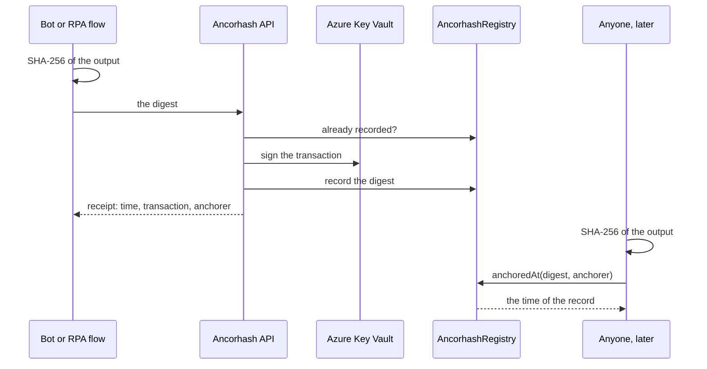

# Ancorhash

[](https://github.com/N0g4D/ancorhash/actions/workflows/backend.yml)
[](https://github.com/N0g4D/ancorhash/actions/workflows/contracts.yml)
[](LICENSE)

**Proof of what an automated process produced, and when.**

Bots, RPA flows and AI agents produce documents, reports and decisions that
someone may need to check months later. Ancorhash records a fingerprint of
each output on a public blockchain when the output is produced. Anyone who
holds the output can later prove that it existed at that time and has not
changed since, without trusting Ancorhash, the operator of the bot or its
logs.

> **Status: early.** The registry runs on Ethereum Sepolia at
> [`0x929673BD5629c84453aA1d2d733aA31836E62fCE`](https://sepolia.etherscan.io/address/0x929673BD5629c84453aA1d2d733aA31836E62fCE#code),
> with its source verified on Etherscan. The code has not been audited: do not
> rely on it on mainnet yet.

## Why

The audit trail of an automated process usually lives in logs kept by
whoever runs the process. When a regulator, an auditor or a counterparty
questions an output, those logs are the operator's word. A record on a public
chain is a time that nobody, Ancorhash included, can change or delete
afterwards. And the output itself never leaves the company: only its SHA-256
digest does.

## How it works

1. The bot computes the SHA-256 of an output where it runs: in a script, in
   the browser, or in a Power Automate Desktop flow with *Hash from file*.
2. It sends the digest, never the file, to the Ancorhash API.
3. Ancorhash records the digest on `AncorhashRegistry`, a contract with no
   owner and no upgrade path, and returns a receipt: the time of the record,
   the transaction and the address it is recorded under.
4. To verify, anyone recomputes the SHA-256 of the output and reads
   `anchoredAt(digest, anchorer)` on the registry: in Etherscan's Read
   Contract, or with [`tools/verify_receipt.py`](tools/verify_receipt.py),
   which needs nothing but Python.

A digest that is already recorded keeps its first time, so a bot can always
retry safely.



The API pays the gas from its own relayer account, which signs with a
secp256k1 key in Azure Key Vault that never leaves the vault. The people who
run the bots need no wallet and no cryptocurrency.

A record proves that a digest existed, in that exact form, no later than the
time of its block, and that the address it is recorded under authorised it.
It does not prove that the output is correct, or who is behind the address.
See [what a record proves, and what it does not](src/Ancorhash.Contracts/README.md#what-a-record-proves-and-what-it-does-not).

## Verify it yourself

This repository holds a sample output of a bot,
[`docs/examples/reconciliation.csv`](docs/examples/reconciliation.csv), and
the [receipt](docs/examples/reconciliation.receipt.json) the API returned when
its digest was recorded on Sepolia. To check it you need Python 3.9 or later
and nothing else:

```bash
python3 tools/verify_receipt.py docs/examples/reconciliation.receipt.json \
  --file docs/examples/reconciliation.csv \
  --rpc https://ethereum-sepolia-rpc.publicnode.com
```

```text
digest: matches the receipt
chain: recorded at 2026-11-26T22:58:00+00:00 under 0xA2642Fb7fd209B3d7b875A2B88e2b3BF8d32EA7B
OK
```

The script computes the SHA-256 of the file and reads the record from the
registry through the RPC endpoint you choose: it never contacts Ancorhash.
Change one byte of the file and the check fails.

## Built for the Microsoft stack

Ancorhash is meant to run in the Azure tenant of the organisation that runs
the bots: the API on Azure Functions, the keys in Azure Key Vault, and Power
Automate as the first client.

## Roadmap

- [x] `AncorhashRegistry` on Ethereum Sepolia, with verified source
- [x] Idempotent anchoring through the registry
- [x] Relayer key in Azure Key Vault
- [ ] A public demo, separate from the API keys for integrations
- [ ] Runs: many outputs in one record, with a receipt for each output
- [ ] A page to verify a file and its receipt
- [ ] A Power Automate Desktop subflow
- [ ] A Power Platform custom connector
- [ ] Mainnet

## Repository

| Path | What |
|---|---|
| `src/Ancorhash.Contracts` | `AncorhashRegistry` in Solidity, with Foundry tests and deployment |
| `src/Ancorhash.Core`, `Infrastructure`, `Api` | The API: .NET 10, Azure Functions (isolated worker), Nethereum |
| `src/Ancorhash.Web` | The demo web app: React, TypeScript, Vite |
| `tests/Ancorhash.Tests` | Unit tests, and integration tests against anvil |
| `tools/verify_receipt.py` | A receipt verifier that needs only Python |
| `docs/examples` | A sample output and its receipt, to try the verifier |
| `docs/tasks` | Planned work, one file per task |

## Author

Built by [Alessio Malerba](https://alessiomalerba.it), Power Platform solution
architect and Solidity developer. I am looking for a first pilot: if you run
bots or agents whose outputs someone else has to trust, write to me on
[LinkedIn](https://www.linkedin.com/in/alessiomalerba-tech/).

## License

Apache License 2.0: see [LICENSE](LICENSE).

## Local development setup

### Prerequisites
- Node.js 20+
- .NET 10 SDK
- Azure Functions Core Tools (`func`)

### 1. Backend setup
Navigate to the API project and restore dependencies:
~~~bash
cd src/Ancorhash.Api
dotnet restore
~~~
Create a `local.settings.json` file with standard RPC URLs, the address of `AncorhashRegistry` and the relayer key. The registry has the same address on every chain: `script/DeployRegistry.s.sol` prints it (see `src/Ancorhash.Contracts/README.md`), and the API refuses to start without a checksummed address. The relayer signs with a secp256k1 key in Azure Key Vault (see [Relayer key in Azure Key Vault](#relayer-key-in-azure-key-vault)): locally, `DefaultAzureCredential` uses your `az login`, and your account needs the same role on the key as the Function App:
~~~json
{
  "IsEncrypted": false,
  "Values": {
    "FUNCTIONS_WORKER_RUNTIME": "dotnet-isolated",
    "Logging__LogLevel__Default": "Information",
    "Blockchain__Relayer__KeyVaultUri": "https://YOUR-VAULT.vault.azure.net/",
    "Blockchain__Relayer__KeyName": "ancorhash-relayer",
    "Turnstile__SecretKey": "1x0000000000000000000000000000000AA",
    "Blockchain__RegistryAddress": "0xYOUR_REGISTRY_ADDRESS",
    "Blockchain__Networks__11155111__RpcUrl": "https://sepolia.infura.io/v3/...",
    "Blockchain__Networks__11155111__Name": "Ethereum Sepolia",
    "Blockchain__Networks__11155111__NativeCoinId": "ethereum",
    "Blockchain__Networks__11155111__IsTestnet": "true",
    "Blockchain__Networks__11155111__ExplorerUrl": "https://sepolia.etherscan.io"
  },
  "Host": {
    "CORS": "http://localhost:5173",
    "CORSCredentials": false
  }
}
~~~
For local development on test networks, such as anvil or Sepolia with a throwaway key, `Evm__RelayerPrivateKey` can take the place of the two `Blockchain__Relayer__*` settings. The API refuses to start with it in Azure, next to the Key Vault settings, or while any network has `IsTestnet` false. It tells local from Azure by the `Development` environment, which Core Tools sets in `AZURE_FUNCTIONS_ENVIRONMENT` and `local.settings.json` cannot change; in Azure the environment is `Production` unless that setting says otherwise, so never set it to `Development` there.

Run the backend:
~~~bash
dotnet run
~~~

### 2. Frontend setup
In a new terminal, navigate to the Web project:
~~~bash
cd src/Ancorhash.Web
npm install
~~~
Create a `.env` file for the Turnstile public test key:
~~~env
VITE_TURNSTILE_SITEKEY="1x00000000000000000000AA"
~~~
Start the Vite development server:
~~~bash
npm run dev
~~~
Open `http://localhost:5173` in your browser.

### 3. Tests
~~~bash
dotnet test Ancorhash.slnx
~~~
The integration tests start `anvil` on a free port and deploy the registry with `forge script`. The relayer signs either with a raw key or through `ExternalAccount`, the account used with Key Vault, with a local key in place of the vault. They are marked `Category=Integration` and skipped when `anvil` or `forge` is not on the `PATH`; `dotnet test --filter "Category!=Integration"` leaves them out explicitly.

---

## Relayer key in Azure Key Vault

The relayer pays the gas and is the anchorer of every record. In the cloud it holds no private key: it signs with a non-exportable secp256k1 key in Azure Key Vault, and the private key never leaves the vault.

On a new subscription, register the Key Vault resource provider first: `az provider register --namespace Microsoft.KeyVault`. Some regions, such as West Europe, may not accept new resources from new subscriptions: pick another one, and keep the vault and the Function App in the same region.

1. Create the key:
   ~~~bash
   az keyvault key create --vault-name <vault> --name ancorhash-relayer \
     --kty EC-HSM --curve P-256K --ops sign verify
   ~~~
   `P-256K` is Azure's name for secp256k1, and the relayer signs with the matching algorithm, `ES256K`. `EC-HSM` keys are protected by an HSM and need the Premium tier; on the Standard tier use `--kty EC`.

2. Give the Function App's managed identity the **Key Vault Crypto User** role on the key, which lets it read the public key and sign. The vault must use the Azure RBAC permission model:
   ~~~bash
   az role assignment create --role "Key Vault Crypto User" \
     --assignee-object-id "$(az functionapp identity show --name <function-app> --resource-group <rg> --query principalId -o tsv)" \
     --assignee-principal-type ServicePrincipal \
     --scope "$(az keyvault show --name <vault> --query id -o tsv)/keys/ancorhash-relayer"
   ~~~
   With a user-assigned identity, also set `AZURE_CLIENT_ID` to its client ID, so that `DefaultAzureCredential` picks it.

3. In the Function App settings, set `Blockchain__Relayer__KeyVaultUri` to `https://<vault>.vault.azure.net/` and `Blockchain__Relayer__KeyName` to `ancorhash-relayer`. Leave out `Evm__RelayerPrivateKey`, both as an app setting and as an `Evm--RelayerPrivateKey` secret in the vault that `KeyVault__Uri` loads: the API refuses to start with a raw key in Azure.

4. Fund the relayer's address on each network. The API logs it the first time it uses a network; to read it from the key beforehand (needs `python3` and Foundry's `cast`):
   ~~~bash
   PUBKEY=$(az keyvault key show --vault-name <vault> --name ancorhash-relayer --query key -o json \
     | python3 -c 'import base64, json, sys; k = json.load(sys.stdin); d = lambda v: base64.urlsafe_b64decode(v + "=" * (-len(v) % 4)); print("0x" + (d(k["x"]) + d(k["y"])).hex())')
   cast to-check-sum-address "0x$(cast keccak "$PUBKEY" | cut -c 27-)"
   ~~~

Do not create new versions of the key. The relayer always signs with the current version, and each version is a different key pair, so a different relayer address: receipts already issued stay verifiable under the old address, but a digest sent again would be anchored again under the new one, with a new time.

---

## Notarization API

Both endpoints take digests computed by the client: 32 bytes, as 64 hex characters (with or without `0x`, any case) or as Base64, which is what Power Automate Desktop's *Hash from file* returns. The zero digest is rejected.

- `POST /api/v1/notarize`: `document_id`, `document_hash`, `chain_id`.
- `POST /api/v1/notarize/batch`: `items` (1 to 100 of `{document_id, document_hash}`) and `chain_id`, anchored with one transaction. The response holds one entry per item, in the same order.

Each entry is a self-contained receipt:

~~~json
{
  "status": "success",
  "document_id": "invoice-42.pdf",
  "digest": "0x10fd2bb778aa0c869b203add42a3bec07e74e428153388b80db340a9df4744d1",
  "chain_id": 11155111,
  "registry": "0x…",
  "anchorer": "0x…",
  "anchored_at": "2026-11-22T10:15:30Z",
  "anchored_at_unix": 1795342530,
  "tx_hash": "0x…",
  "already_anchored": false,
  "explorer_url": "https://sepolia.etherscan.io/tx/0x…"
}
~~~

Anchoring is idempotent. A digest the relayer has already anchored returns HTTP 200 with the original `anchored_at`, `tx_hash: null` and `already_anchored: true`, and costs no transaction, so retrying a request is always safe. When the transaction is sent but its receipt does not arrive within `Blockchain:ReceiptTimeoutSeconds` (90 by default), the response is HTTP 202 with `status: "pending"`, the `tx_hash` and `anchored_at: null`. Sending the same request again once that transaction is mined returns the time. A retry while it is still pending returns HTTP 202 with the same `tx_hash` and sends nothing: each instance remembers its pending transactions for 10 minutes, so a transaction dropped from the mempool does not block the digest for longer. With several instances, a retry can at worst send one more transaction, which anchors nothing new. An invalid digest is HTTP 400.

Anyone can verify a receipt without trusting Ancorhash: `anchoredAt(digest, anchorer)` on the registry returns `anchored_at_unix`.

---

## Security & protections

Since Ancorhash pays the transaction fees, the `/api/v1/notarize` endpoint is a highly critical surface. It is protected by a multi-layered defense strategy:
1. **IP Rate Limiting:** Discards requests aggressively at the middleware layer if an IP exceeds the allowed threshold (HTTP 429), saving CPU and API calls.
2. **Cloudflare Turnstile:** Blocks headless browsers and automated scripts via cryptographic challenges (HTTP 403).
3. **Fail-Safe Orchestration:** Any failure in the RPC nodes or pricing oracles is caught, logged via OpenTelemetry, and handled gracefully without crashing the host process.

---

## Historical note

Ancorhash started as a Python and FastAPI proof of concept, preserved under the [`python-poc`](https://github.com/N0g4D/ancorhash/tree/python-poc) tag.
